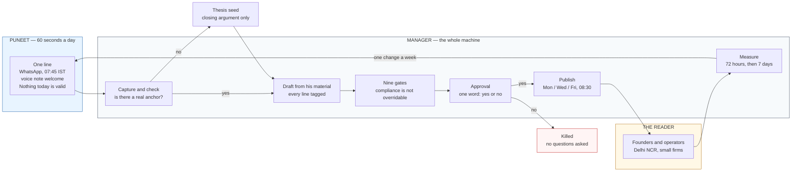
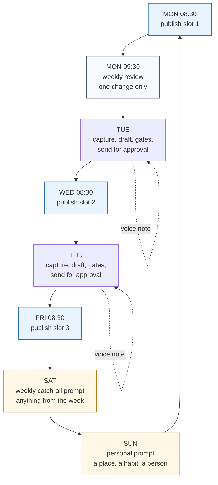
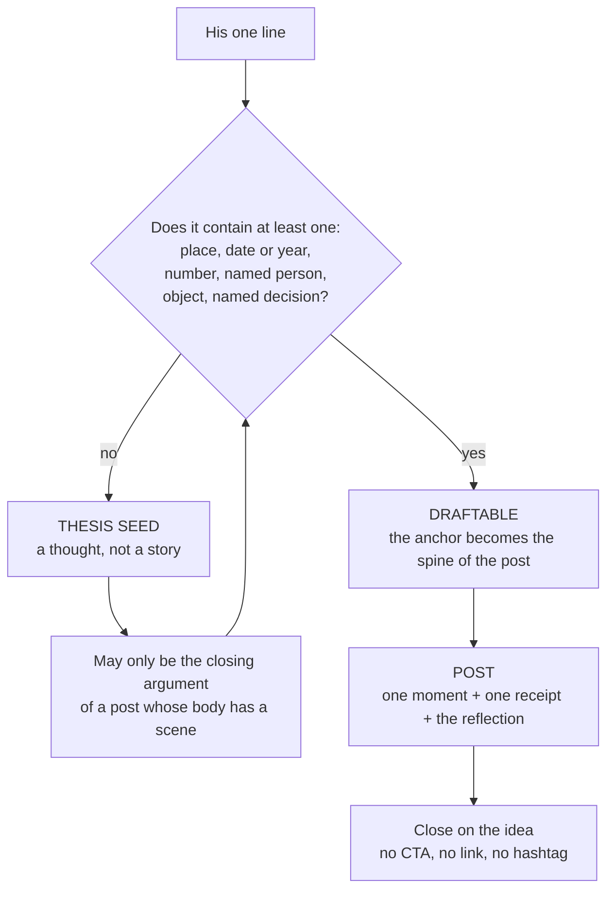
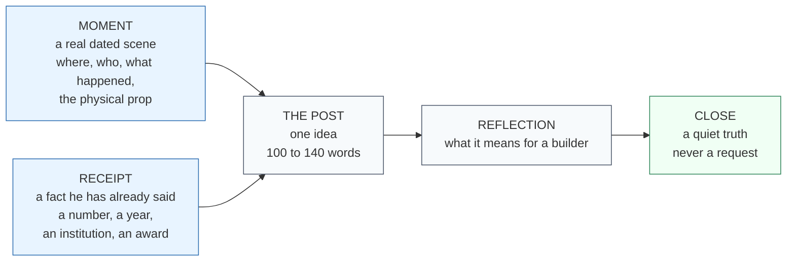
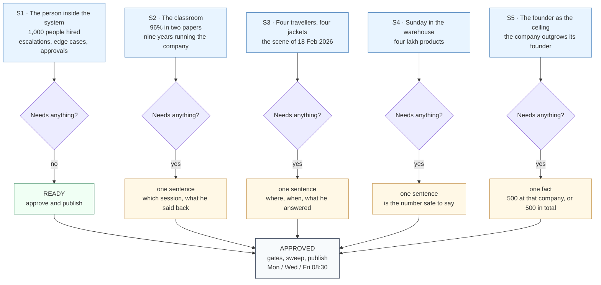
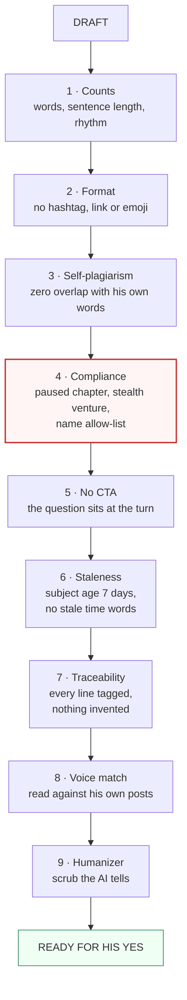
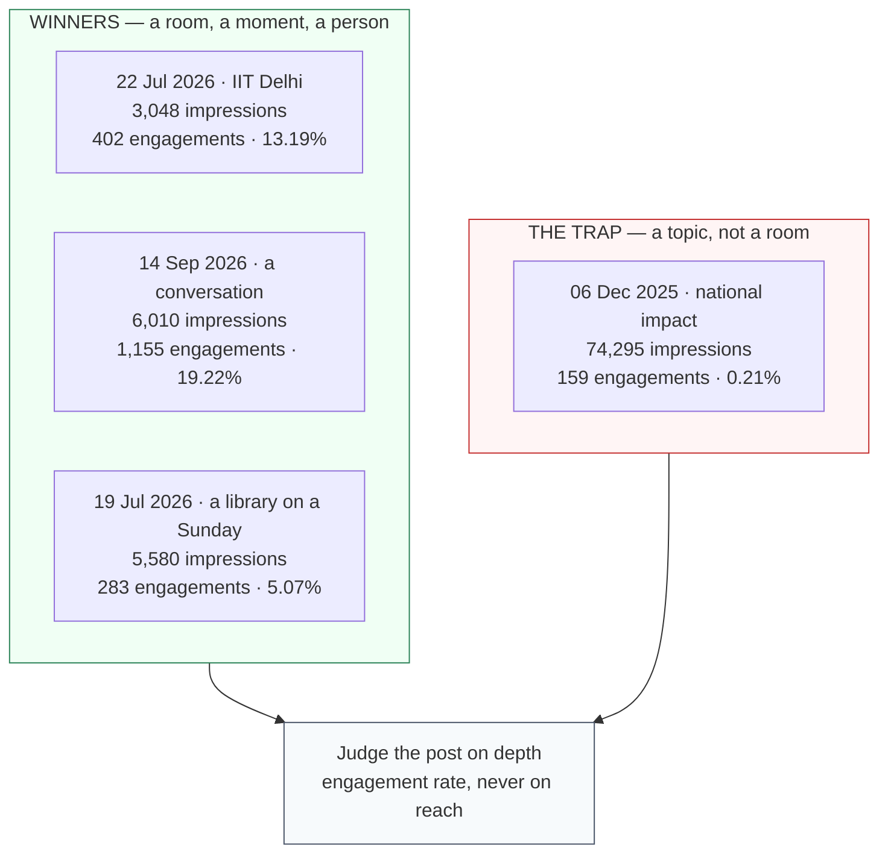
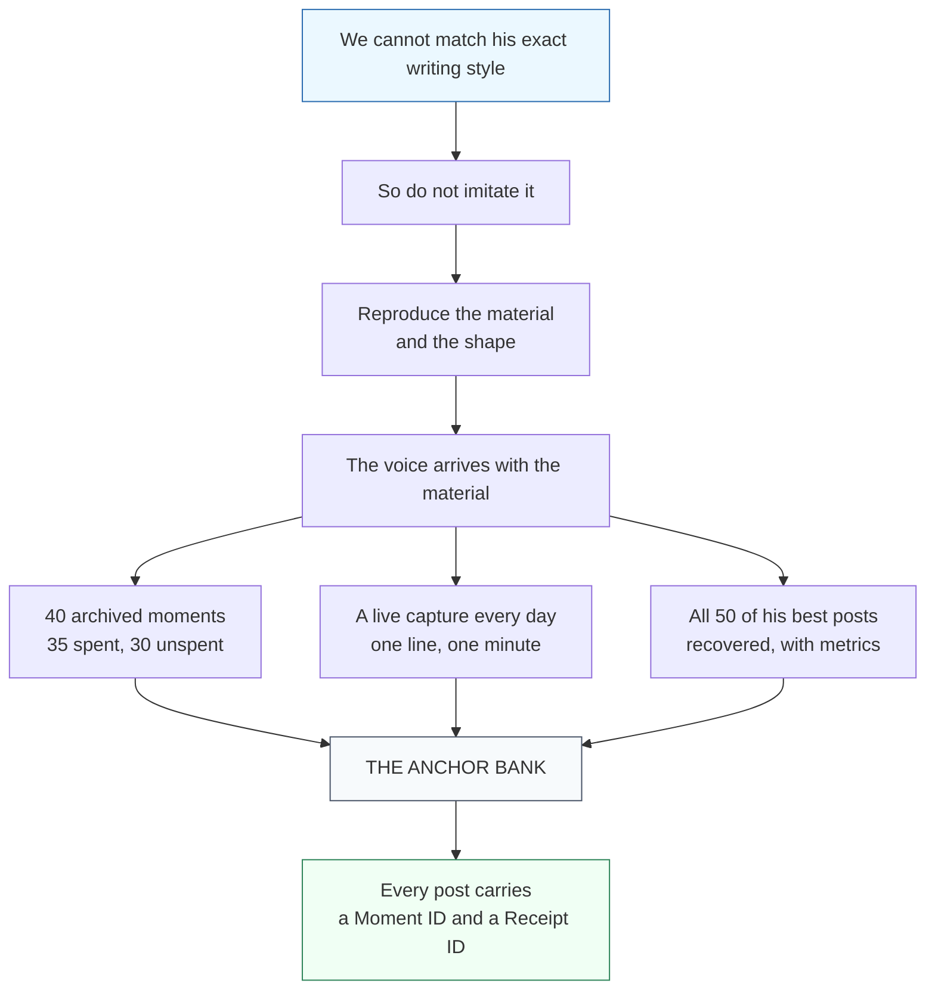
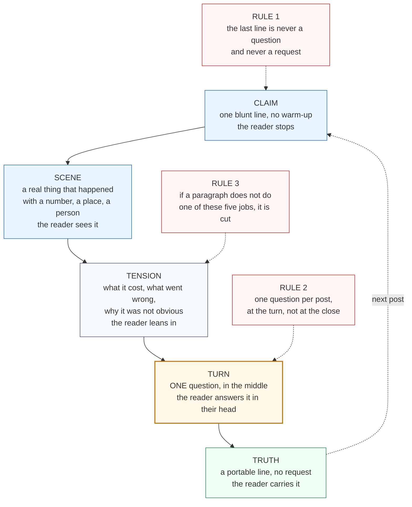
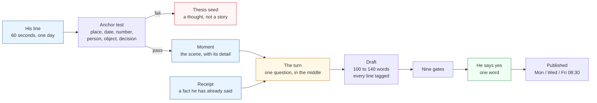

# 25_WORKFLOW_DIAGRAMS.md — Excalidraw-ready Mermaid

> **INTERNAL ONLY — DO NOT SHARE.** Presentation material for the meeting with Puneet.
> Not for external distribution.

**Created:** 2026-10-21
**How to use:** Excalidraw → left panel → **Mermaid** → paste one block → it converts to editable
shapes. Export to PNG/SVG for the deck. Each block is self-contained; paste them one at a time.

**Slide order for the meeting:** 1 · 2 · 4 · 6 · 3 — then the five drafts (block 5).

---

# BLOCK 1 — The system in one picture (opening slide)

---

# BLOCK 2 — The weekly rhythm (how a week actually runs)

---

# BLOCK 3 — The anchor test (the rule that keeps the feed real)

---

# BLOCK 4 — Anatomy of a post (why it sounds like him)

---

# BLOCK 5 — The five drafts and what each one needs

---

# BLOCK 6 — The gate ladder (nothing goes out half-checked)

---

# BLOCK 7 — Depth, not reach (the proof slide)

---

# BLOCK 8 — The answer to "we cannot match his writing style"

---

# BLOCK 9 — The story spine (the answer to "it reads like a list of sentences")

---

# BLOCK 10 — From a line to a post (the transformation, for the "how do you do this" question)

---

# Slide copy (paste under each diagram)

**1 · The system.** He gives 60 seconds a day. We do the rest. Nothing goes out without his yes.
One word kills a post and we never ask why.

**2 · The rhythm.** Three posts a week, Monday Wednesday Friday at 08:30. Monday is the only day
his own data supports on both measures. A slot is skipped without apology.

**3 · The rule.** If his line has no place, date, number, person or object in it, it is not a
post. It is a thought, and it can only close a post that has a scene.

**4 · The anatomy.** One real moment. One fact he has already said. What it means for a builder.
Close on the truth, never on a request.

**5 · The ask.** Five drafts, four one-sentence answers, one fact to confirm. Yes, no, or not me.

**6 · The gates.** Nine checks, cheapest first. The compliance gate is the one the manager cannot
override.

**7 · The proof.** 25 of his 50 best posts name a place. 25 name a person. 22 use a number. The
biggest post of the year earned 0.21% engagement. The best post of the period earned 13.19% on
a third of the reach.

**8 · The honesty.** We were never going to imitate his voice. We put his own moments back in
front of him and let him approve them.
