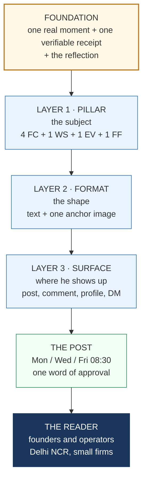
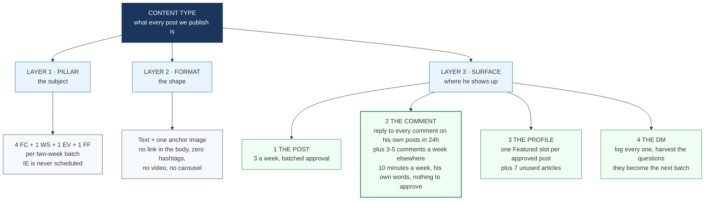
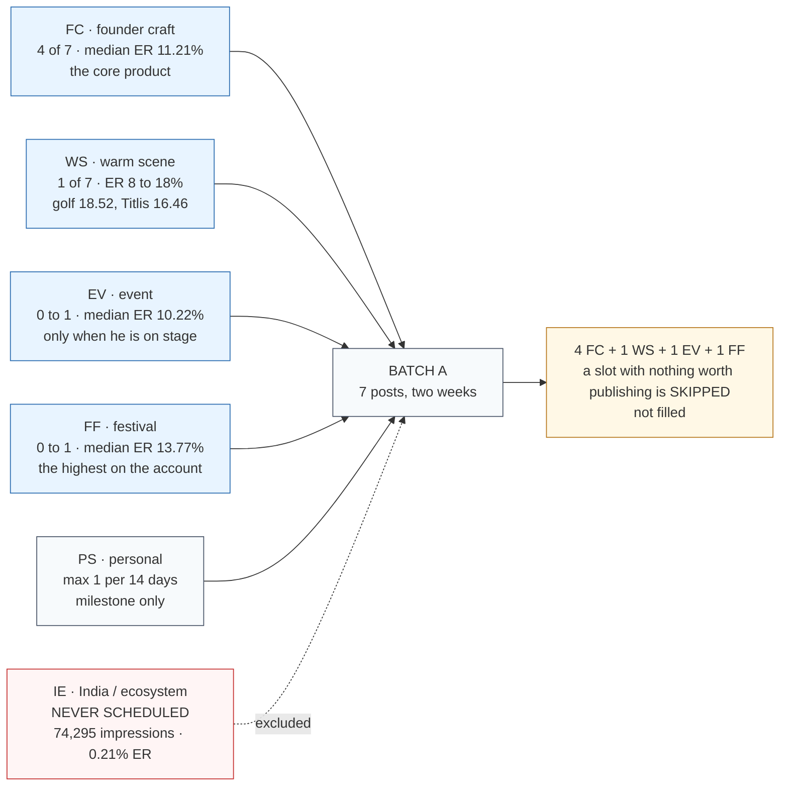
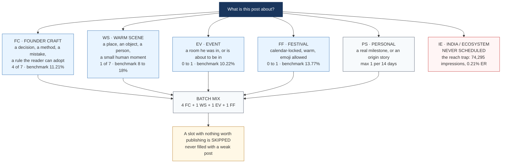
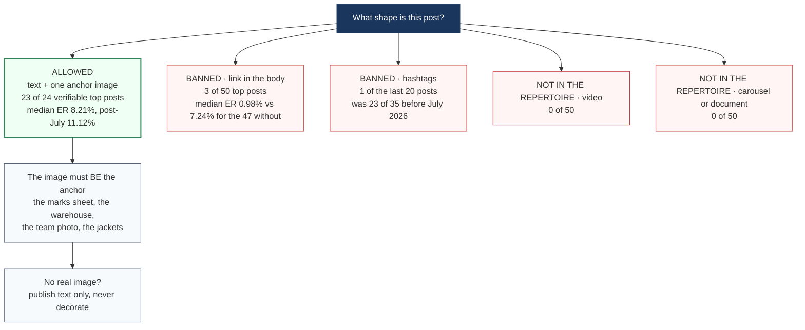
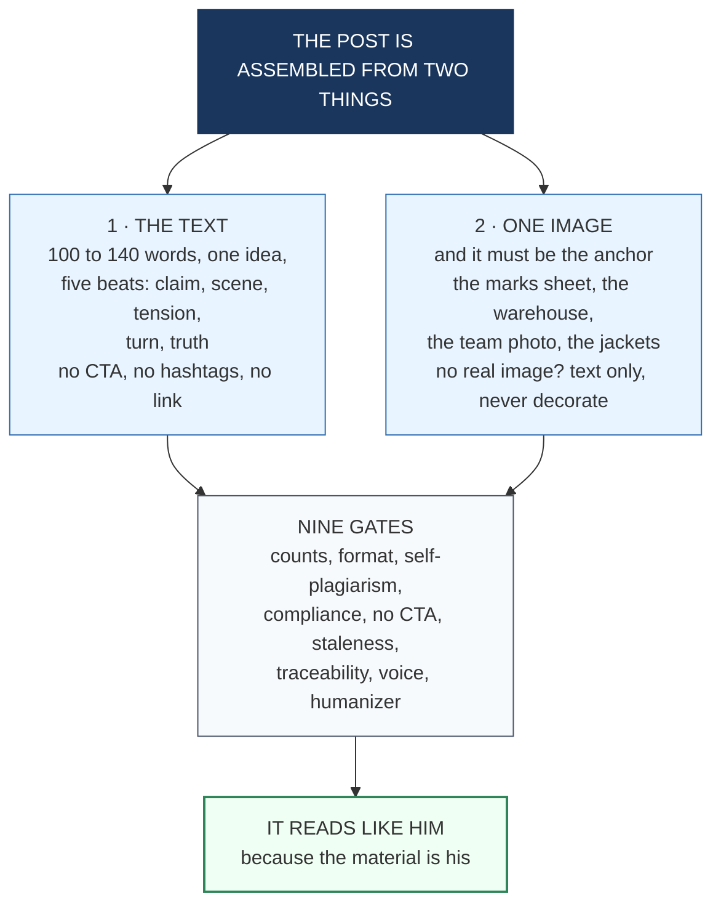
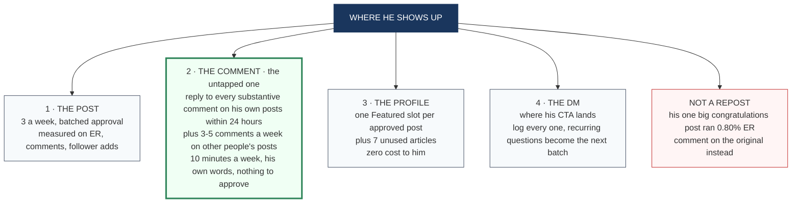
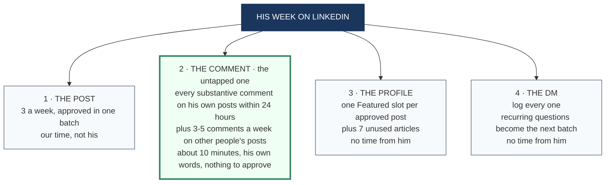
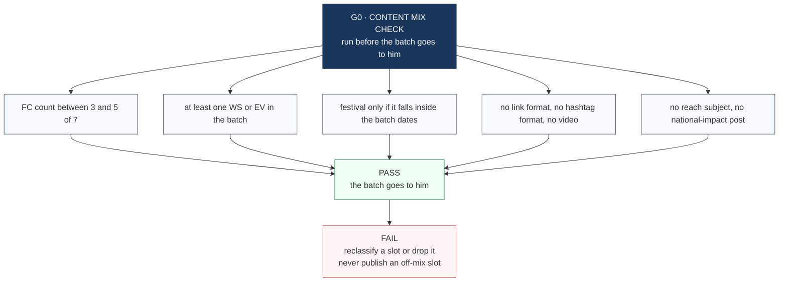

# 28_CONTENT_TYPES.md — what we actually publish

> **INTERNAL ONLY — DO NOT SHARE.** The content-type system: pillars, formats and surfaces.
> Not for external distribution.

**Created:** 2026-10-21
**Purpose:** the answer to "what is the content type?" — and it has three layers, not one. A content
plan that names only the subject (a "pillar") leaves the shape and the surface undecided, and both
of those decide the result. Every rule below is read from his own data, not from a best practice.

---

## THE DIAGRAMS (paste into Excalidraw)

**How to use:** Excalidraw → left panel → **Mermaid** → paste one block → it converts to editable
shapes → rearrange, label, export. Every block below is validated against mermaid v11 (0 failures).
**Slide order: 1 → 2 → 3 → 4 → 5 → 6 → 7 → 8 → 10 → 9.**
Diagram 1 is the fan of the three layers, Diagram 2 is the same three layers as a stack,
and Diagrams 3, 4 and 5 are one deep-dive per layer.

### Diagram 1 — the three layers (opening slide)

### Diagram 2 — the same three layers as a stack (foundation to reader)

---

## LAYER 1 — PILLARS: what the post is about

Six types. Five are scheduled, one is banned from the calendar.

| Code | Pillar | What it is | Per 2-week batch | Benchmark ER (post-18 Jul 2026) | Evidence |
|---|---|---|---|---|---|
| **FC** | Founder craft / operator lesson | a decision, a process, a method, a mistake, a rule a reader can adopt | **4 of 7** | **11.21%** | 15 posts, the largest share of engaged impressions, the only theme with both volume and depth |
| **WS** | Warm scene | a place, an object, a person, a small human moment with no lesson bolted on | **1 of 7** | golf 18.52% · Titlis 16.46% · library 5.07% | his highest individual ERs are all scenes |
| **EV** | Event / ecosystem | a room he was in, or one he is about to be in | **0–1, only when he is actually on stage** | 10.22% | the 2026-09-14 post — a conversation, 1,155 engagements — is the best post of the year |
| **FF** | Festival / faith | calendar-locked, warm, emoji permitted | **0–1, and only on the festival date** | **13.77%** | the highest ER on the account |
| **PS** | Personal / origin | a real milestone, or an origin story not used in 6+ months | **≤1 per 14 days** | 8–9% | |
| **IE** | India / ecosystem / policy | a national point of view | **0 — never scheduled** | 11.74% on a tiny n, and it buys reach, not depth | the reach trap: 74,295 impressions, 0.21% ER |

**The mix rule:** **4 FC + 1 WS + 1 rotating (FF or EV or PS) + 1 slot that is FF on the calendar.**

**The rule that matters more than the mix:** a slot is skipped rather than filled. A weak FC is
worse than a missing FC, and a skipped slot costs nothing. "We have nothing worth posting" is a
valid state.

**Batch A, as built:** S1 FC · S6 FC · S4 FC · S2 FC · S3 WS · S7 **EV** · S9 FF = **4 FC + 1 WS +
1 EV + 1 FF**. Exactly on target. S7 was reclassified from FC to EV — it is a fireside, not a
lesson, and mislabelling it would have produced five FC in seven and a run of lessons that reads
like a lecture series.

### Diagram 6 — the pillar mix

### Diagram 3 — Layer 1 in detail: which pillar is this post?

---

## LAYER 2 — FORMATS: what shape the post takes

This is where the data is blunt. **There is exactly one format that works on this account, and
everything else is either absent from the top 50 or actively bad.**

| Format | In the top 50? | Median ER | Verdict |
|---|---|---|---|
| **Text + one image** | **yes — 23 of the 24 top posts the archive can verify, and it is the only shape present** | 8.21% (post-July 11.12%) | **The format. Nothing else is needed.** |
| **Text, no image** | 1 of 24 | 9.88% | n=1, no signal either way |
| **Link in the body** | **3 of 50** | **0.98%** vs 7.24% for the 47 without | **Banned.** Three of the four lowest-ER posts in the top 50 have a link in them |
| **Hashtags** | 1 of 20 recent posts (pre-July: 23 of 35, ~5 each) | — | **Zero.** The hashtag era ended with the regime break and it should not come back |
| **Video** | **0 of 50** | — | Not in the repertoire. Do not start — it needs his voice and a production loop he does not have |
| **Document / carousel** | **0 of 50** | — | Not in the repertoire |
| **Multi-image** | no evidence | — | Not in the repertoire |

**The image rule:** one image, and it must be **the anchor** — the marks sheet, the warehouse, the
team photograph, the jackets, the awards wall. His images are memories, not decoration. If there is
no real image for the post, publish text only rather than decorate with a stock visual.

**The link rule:** never in the body. If an event needs a register link, it goes in the first
comment, and only on an EV promo. Our own gate G2 already enforces this.

### Diagram 7 — the format decision, with the evidence

### Diagram 4 — Layer 2 in detail: what the post is made of

---

## LAYER 3 — SURFACES: where the content lives

A post is only one of four places a founder shows up. We have designed exactly one. The other three
cost him nothing because he already does them informally — they just need a rule.

| Surface | What it is | Rule | Cost to him | Measurable in |
|---|---|---|---|---|
| **1 · The post** | the weekly output | 3 per week, batched approval | one word per post | ER, comments, follower adds |
| **2 · The comment** | the untapped one | reply to **every substantive comment on his own posts within 24 hours**, in his voice — name, thank, one line back. Plus **3–5 comments a week on other people's posts**, in the founder/jury ecosystem he already sits in | ~10 minutes a week, in his own words, no approval needed | comments, unique commenters, follower adds |
| **3 · The profile** | headline, About, Featured | **one Featured slot per approved post.** A published post becomes a Featured item, so every post gets a second surface for free. His 7 articles are unused assets | zero, we do it | profile views, inbound |
| **4 · The DM** | where his CTA lands | log every DM; the recurring questions in the DMs become the next batch's material | zero | DMs logged, questions harvested |
| **5 · The repost** | amplifying someone else's news | **comment instead.** His one "big congratulations" post ran at 0.80% ER | zero | — |

**Why the comment surface is the biggest unclaimed win:** his posts draw 40–84 comments each, and
those are people who chose to talk to him. A comment strategy is the only part of LinkedIn
management that produces depth *without* producing another post, and the only part he can execute
without us drafting anything.

**The repost finding:** his single "big congratulations" post (2025-11-11) ran 4,612 impressions at
0.80% ER — a repost-shaped post about someone else's news. Commenting on the original gets the same
association with none of the reach-chasing.

### Diagram 8 — the four surfaces

### Diagram 5 — Layer 3 in detail: what his week actually looks like

---

## WHAT WE DELIBERATELY DO NOT DO

| Not doing | Why |
|---|---|
| Video | 0 of 50 top posts. It needs his face and a production loop he does not have |
| Carousels / documents | 0 of 50 |
| Hashtags | 1 in the last 20 posts. The era ended with the regime break |
| Links in the body | 3 of 50, and those 3 average 0.98% ER against 7.24% |
| Engagement-bait CTAs | his corpus has a CTA in 6 of 26 posts, four of them event logistics |
| Reach-first India/ecosystem posts | the trap: 74,295 impressions, 159 engagements |
| Posting every slot at any cost | a skipped slot is free; a weak post is not |
| A newsletter | no evidence in the corpus, and it is a second audience to build |
| Polls | no evidence in the corpus, and they measure nothing we act on |

---

## THE CONTENT PLAN TEMPLATE (every batch)

| Slot | Date | Pillar | Format | Moment ID | Receipt ID | Needs from him | Benchmark | Status |
|---|---|---|---|---|---|---|---|---|
| 1 | Mon 26 Oct | FC | text + 1 image | L-23 | R-41 | — | 11.21% | drafted |
| 2 | Wed 28 Oct | FC | text + 1 image | L-26 | R-26 | — | 11.21% | drafted |
| 3 | Fri 30 Oct | FC | text + 1 image | M-28 | R-06 | one yes/no | 11.21% | drafted |
| 4 | Mon 2 Nov | FC | text + 1 image | M-32 | R-12 | one fact | 11.21% | drafted |
| 5 | Wed 4 Nov | WS | text + 1 image | M-53 | R-45 | one fact + names | 8–18% | drafted |
| 6 | Fri 6 Nov | EV | text + 1 image | L-05 | R-47 | one fact | 10.22% | drafted |
| 7 | Sun 8 Nov | FF | text + 1 image | M-42-adjacent | R-27 | one fact | 13.77% | drafted |
| spare | — | FC | text + 1 image | L-18 | R-19 | one fact | 11.21% | drafted |
| spare | — | FC | text + 1 image | M-40-adjacent | R-13 | blocked | 11.21% | drafted |

**Content mix check, run on every batch before it goes to him (gate G0):** FC count between 3 and
5 of 7 · at least one WS or EV · festival only if it falls in the batch's dates · no slot with a
"link" format · no slot with a "hashtag" format · no slot with a "reach" subject.

### Diagram 9 — the G0 mix check

### Diagram 10 — Batch A, slot by slot

```mermaid
flowchart LR
    S1["1 · Mon 26 Oct<br/>FC · founder craft<br/>L-23 + R-41 · needs nothing"] --> S2["2 · Wed 28 Oct<br/>FC · founder craft<br/>L-26 + R-26 · needs nothing"]
    S2 --> S3["3 · Fri 30 Oct<br/>FC · founder craft<br/>M-28 + R-06 · one yes/no"]
    S3 --> S4["4 · Mon 2 Nov<br/>FC · founder craft<br/>M-32 + R-12 · one fact"]
    S4 --> S5["5 · Wed 4 Nov<br/>WS · warm scene<br/>M-53 + R-45 · one fact + names"]
    S5 --> S6["6 · Fri 6 Nov<br/>EV · event<br/>L-05 + R-47 · one fact"]
    S6 --> S7["7 · Sun 8 Nov<br/>FF · festival, on the day<br/>M-42 + R-27 · one fact"]
    S7 --> SP["2 SPARES READY<br/>S8 the listening habit · S5 the founder as the ceiling"]
    style S1 fill:#e8f4ff,stroke:#2b6cb0
    style S2 fill:#e8f4ff,stroke:#2b6cb0
    style S3 fill:#e8f4ff,stroke:#2b6cb0
    style S4 fill:#e8f4ff,stroke:#2b6cb0
    style S5 fill:#fff8e6,stroke:#b7791f
    style S6 fill:#fff8e6,stroke:#b7791f
    style S7 fill:#f0fff4,stroke:#2f855a
    style SP fill:#f7fafc,stroke:#4a5568
```

---

## THE ONE-LINE VERSION

> **Four founder lessons, one warm scene, one event or festival, one real picture each, no links,
> no hashtags, no video, no carousel — and a comment on someone else's post every week.**
